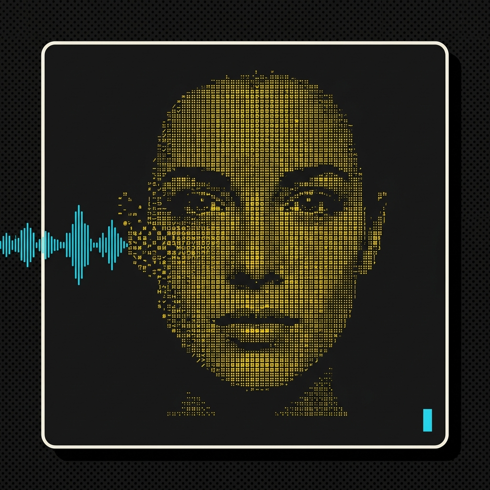

<div align="center">


# **VOXCELL** `//` FOR HERMES DUET

**Voice in. Character out.**

A cyberpunk voice-activated phone widget and interactive command-line interface
for [Hermes Duet](https://github.com/DevvGwardo/hermes-duet) — with a real-time,
audio-synced, animated ASCII character as your call screen.

[](https://bun.sh)
[](https://react.dev)
[](https://www.typescriptlang.org)
[](https://vite.dev)
[](https://tailwindcss.com)
[](#the-engine-bay)

*Repo: `hermes-agentis` · Brand kit: [`branding/`](branding/)*

</div>

---

## What it is

Talk to your agent. Watch it think.

Voxcell is a voice-first front end for **Hermes Duet**. You speak; your request goes to the
real Hermes gateway and the real Duet server (state, runs, approvals — not a mock). The reply
comes back as synthesized speech, and a **character made of ASCII and Braille cells animates
on screen, synced live to the audio**. Every word, rendered live.

Two surfaces ship in one app:

- **The phone widget** — a portrait video-call-style surface with the character on screen.
- **The command terminal** — an interactive CLI for sessions, approvals, and agent control.

<table>
<tr>
<td width="55%">

**The character**

A face built entirely from character cells — the same 2×3 Braille dot grid the logo is made
of. It reacts to the voice waveform in real time via the Web Audio `AnalyserNode`, mouth
movements derived from audio amplitude, sprite-based portrait animation for expression.

`Voice in. Character out.` — the pipeline is the product.

</td>
<td width="45%" align="center">



</td>
</tr>
</table>

## The pipeline

One spoken sentence becomes an animated character in six stages:

```text
 MIC ─────▶ SERVER ─────▶ AGENT ─────▶ TTS ─────▶ ANALYSER ─────▶ RENDER
 voice      Express        Hermes       Gemini     Web Audio        ASCII/Braille
 Speech-    POST           Duet         TTS        AnalyserNode     character cells
 Recog-     /api/hermes/   gateway      WAV        amplitude →      audio-synced
 nition     /chat          127.0.0.1    reply      visemes          face animation
                           :8642
                           model
                           hermes-agent
```

Wiring — all real, no placeholders:

- **Duet app** `127.0.0.1:7456` (public) / `:7457` (internal) — sessions, runs, approvals, cards
- **Hermes gateway** `127.0.0.1:8642` — agent chat, model `hermes-agent`
- **This server** pairs itself as a Duet device (pair-code → `/api/pair` → device cookie) on first run

## The engine bay

Eleven engines under `src/utils/` — every single one carries a `.test.ts`. Run them: `bun test`.

| Engine | What it does |
|---|---|
| `asciiPortraitEngine` | the animated face |
| `ascii3dEngine` | 3D character-cell viewport |
| `asciiCharacter` | sprite animation |
| `brailleFieldEngine` | dot-cell field |
| `brailleShapesEngine` | session shapes |
| `portraitLoadingEngine` | character loading state |
| `textDecodeEngine` | decoded agent text |
| `canvasSessions` | sessions as canvas nodes |
| `cliEngine` | the command terminal |
| `threadTrace` | agent thinking trace |
| `uiCustomization` | natural-language UI control |

## Features

- 🎙 **Voice activation** — browser `SpeechRecognition`, always-listening phone experience
- 📞 **Phone video widget** — the character on a call-style screen
- ⌨️ **Command terminal** — `/skills`, `/memory`, `/cron`, `/resume`, session control, approvals
- 🧠 **Thinking trace** — watch the agent's reasoning as a live tree
- 🎨 **UI customizer studio** — talk or type UI changes in natural language
- 🌫 **Glass background system** — 7 ambient presets, motion-bounded, reduced-motion safe
- 👋 **Guided onboarding** — the character itself hosts the first-run tour
- 🧪 **Blueprint harness** — reproducible frame capture and before/after animation diffs (`tools/blueprint/`)

## Quick start

**Prerequisites**

- [Bun](https://bun.sh) (runtime + package manager)
- A Gemini API key (`GEMINI_API_KEY`)
- Hermes Duet running locally (app on `:7456`, gateway on `:8642`)

**Run it**

```bash
git clone https://github.com/DevvGwardo/hermes-agentis.git
cd hermes-agentis
bun install

cp .env.example .env    # then set GEMINI_API_KEY (see table below)

bun run dev             # http://localhost:3000
```

First run pairs the app as a device with your Duet server automatically.

**Environment**

| Variable | Default | Purpose |
|---|---|---|
| `GEMINI_API_KEY` | — | Gemini API (chat turns, TTS) |
| `DEEPGRAM_API_KEY` | — | optional TTS provider (takes priority over Gemini) |
| `HERMES_API_URL` | `http://127.0.0.1:8642` | Hermes gateway |
| `HERMES_API_KEY` | — | gateway bearer token |
| `HERMES_PROFILE` | `default` | Hermes profile |
| `DUET_BASE_URL` | `http://127.0.0.1:7456` | Duet app |
| `DUET_INTERNAL_URL` | `http://127.0.0.1:7457` | Duet internal API |
| `DUET_DEVICE_NAME` | `hermes-agentis` | device name shown in Duet |
| `DUET_TOKEN_FILE` | `../hermes-duet/data/internal.token` | internal token file |
| `DUET_INTERNAL_TOKEN` | — | inline internal token |
| `PORT` | `3000` | dev server port |

**Scripts**

| Command | Does |
|---|---|
| `bun run dev` | dev server (`tsx server.ts`) |
| `bun run build` | production build (`vite build`) |
| `bun run preview` | preview the build |
| `bun run lint` | typecheck (`tsc --noEmit`) |
| `bun test` | run the engine test suite |

## Repo layout

```text
src/
  components/    16 UI components — AsciiPortraitCanvas, PhoneVideoWidget,
                 CommandTerminal, ThreadTraceTree, UiCustomizerStudio, ...
  utils/         11 engines + tests (the engine bay)
  hooks/         useDuet, useVoiceAgent
  backgrounds/   glass background system
  onboarding/    guided tour, hosted by the character
server.ts        Express: agent chat, TTS, Duet device pairing, approvals
tools/blueprint/ reproducible character capture + frame-diff harness
branding/        the Voxcell brand kit (mark, wordmark, art, infographics)
```

## Branding

The name is **Voxcell** — vox (voice) + cell (the character cell it animates).
The mark is the Braille character `⠧` (dots 1·2·3·6 — the V of Voxcell) in a bordered
panel. One neon accent, hard shadows, no glow: cyberpunk-terminal meets the Hermes house style.

<table>
<tr>
<td align="center">


</td>
<td>

The full kit lives in [`branding/`](branding/):

- [`branding/brand.md`](branding/brand.md) — name system, palette, typography, logo rules
- [`branding/README.md`](branding/README.md) — kit contents
- [`branding/infographic.jpg`](branding/infographic.jpg) — product & architecture overview
- [`branding/logo/`](branding/logo/) — wordmark, dark and light

*In-app surfaces still read "Hermes Duet // Cyber Comms" — the brand layer is newer than the code (see [`branding/brand.md`](branding/brand.md)).*

</td>
</tr>
</table>

---

<div align="center">

**VOXCELL** `//` every word, rendered live.

`github.com/DevvGwardo/hermes-agentis`

</div>
