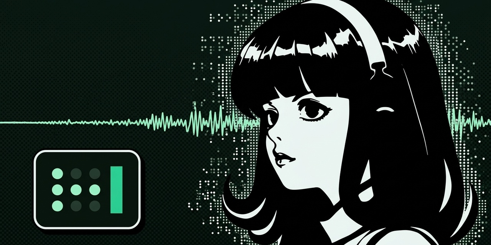
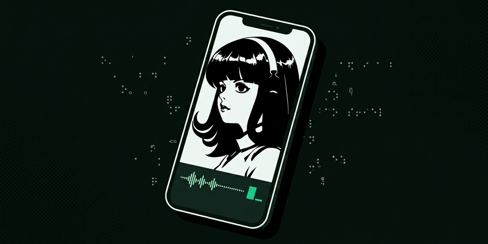
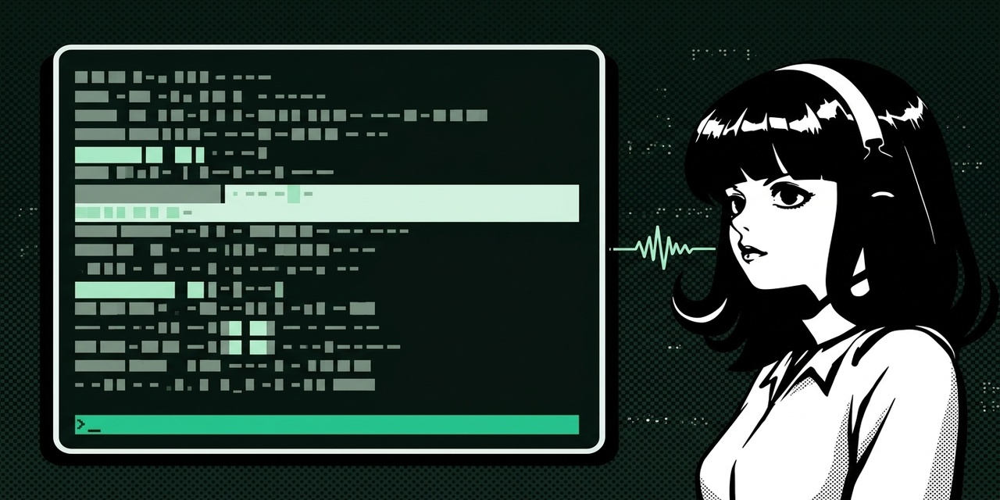
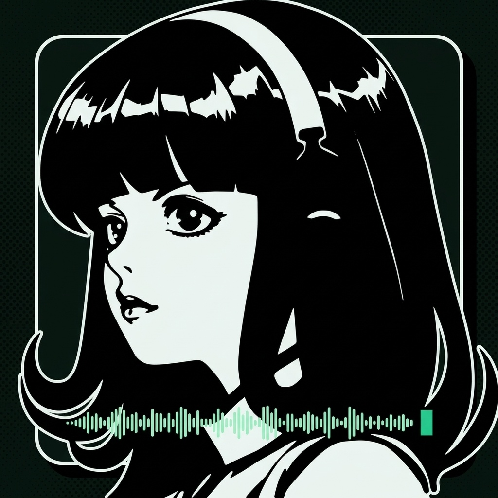

<div align="center">



# **VOXCELL** `//` FOR HERMES AGENT

**Voice in. Character out.**

A cyberpunk voice-activated phone widget and interactive command-line interface
for your local [Hermes Agent](https://hermes-agent.nousresearch.com/docs) —
with a real-time, audio-synced, animated ASCII character as your call screen.

[](https://bun.sh)
[](https://react.dev)
[](https://www.typescriptlang.org)
[](https://vite.dev)
[](https://tailwindcss.com)
[](#the-engine-bay)

*Repo: `hermes-agentis` · Brand kit: [`branding/`](branding/)*

</div>

---

## What it is

Talk to your agent. Watch it think.

Voxcell is a voice-first front end for the **Hermes Agent gateway** — the same
OpenAI-compatible API server that powers the agent on your machine. You speak;
your request goes to the real gateway and the real agent (chat, sessions, tasks,
approvals — not a mock). The reply comes back as synthesized speech, and a
**character made of ASCII and Braille cells animates on screen, synced live to
the audio**. Every word, rendered live.

One backend, no fallbacks: the gateway is the *only* reply source. If it is
down, Voxcell says so — no canned personas, no second model quietly answering.

Multiple surfaces ship in one app:

- **Home & Thread workspace** — the animated halftone character stage paired with live conversation, thinking traces, and background task banners.
- **Braille Sessions Canvas** — draggable parallel session Dots with orbital/constellation formations and inline lane prompts.
- **Command terminal & Operations queue** — an interactive CLI alongside Gateway, Approvals (`/v1/runs`), and Jobs (`/api/jobs`) controls.

<table>
<tr>
<td width="55%">

**The character**

She's the project's own character: a retro-shojo manga ink portrait — black bob with
outward-curled ends, blunt bangs, white headband, choker — rendered live as a
tonal-halftone Braille dither (5 intensity tiers, 8×8 Bayer matrix), with mouth,
blinks and head motion synced to the Web Audio `AnalyserNode` amplitude of the
TTS voice.

`Voice in. Character out.` — the pipeline is the product.

</td>
<td width="45%" align="center">


</td>
</tr>
</table>

## The pipeline

One spoken sentence becomes an animated character in six stages:

```text
 MIC ─────▶ SERVER ─────▶ AGENT ─────▶ TTS ─────▶ ANALYSER ─────▶ RENDER
 voice      Express        Hermes      Deepgram   Web Audio        ASCII/Braille
 Speech-    POST           Agent       Aura-2     AnalyserNode     character cells
 Recog-     /api/hermes/   gateway     WAV        amplitude →      audio-synced
 nition     /chat          127.0.0.1   linear16   visemes          face animation
                           :8642       (or
                           model       browser
                           hermes-     speech)
                           agent
```

Wiring — all real, no placeholders:

- **Hermes Agent gateway** `127.0.0.1:8642` — capability-probed (`GET /v1/capabilities`, `GET /api/model/options`, `GET /health`), supporting `/v1/runs` (plus `/v1/runs/{id}/approval` & `/events`), `/api/sessions/{id}/chat/stream`, and `/v1/chat/completions` (`reasoning_content` + `content`), with `X-Hermes-Session-Id` continuity, `X-Hermes-Session-Key` memory scoping, `Idempotency-Key`, `429` retry, and `/p/<profile>/` routing
- **Live gateway resources** — `GET /v1/skills`, `GET /v1/toolsets`, `GET /api/sessions`, and scheduled jobs (`/api/jobs`)
- **Deepgram Aura-2** — synthesized WAV replies for audio-synced animation (browser `speechSynthesis` fallback)
- **`server.ts` Express proxy** — handles SSE parsing, gateway auth headers, TTS audio synthesis, and canvas dot/channel storage

## The engine bay

Eighteen engines under `src/utils/` — every single one carries a `.test.ts`. Run them: `bun test` (or `npx tsx --test src/utils/*.test.ts`).

| Engine | What it does |
|---|---|
| `asciiPortraitEngine` | the animated face |
| `ascii3dEngine` | 3D character-cell viewport |
| `asciiCharacter` | sprite animation |
| `brailleCanvasRaster` | tonal halftone raster — 5-tier dot buckets, 8×8 Bayer dither |
| `brailleFieldEngine` | dot-cell field |
| `brailleIdleLoops` | ambient idle motion loops |
| `brailleShapesEngine` | session shapes |
| `canvasSessions` | sessions as canvas nodes |
| `cliEngine` | the command terminal |
| `hermesProtocol` | capability discovery, `/p/<profile>/` routing, SSE parsers, retry & idempotency |
| `homeSession` | home session state |
| `motionChoreography` | shared UI motion — sliding indicators, stagger, collapsible timing |
| `portraitLoadingEngine` | character loading state |
| `taskInsights` | task step resolution and background-task rollups |
| `textDecodeEngine` | decoded agent text |
| `threadScroll` | message scroll anchoring |
| `threadTrace` | agent thinking trace |
| `uiCustomization` | natural-language UI control |

## Features

<table>
<tr>
<td width="55%">

- 🎙 **Voice activation** — browser `SpeechRecognition`, always-listening phone experience
- 📞 **Phone video widget** — the character on a call-style screen
- ⌨️ **Command terminal** — `/gateway`, `/skills`, `/toolsets`, `/cron`, `/sessions`, `/tasks`, `/resume`, session control, approvals
- 🧠 **Thinking trace** — watch the agent's reasoning as a live tree
- 📋 **Task lifecycle** — confirm, reopen, cancel, and steer running tasks; banners auto-expand while active
- 🎨 **UI customizer studio** — talk or type UI changes in natural language
- 🌫 **Glass background system** — 7 ambient presets, motion-bounded, reduced-motion safe
- 👋 **Guided onboarding** — the character itself hosts the first-run tour
- 🧪 **Blueprint harness** — reproducible frame capture and before/after animation diffs (`tools/blueprint/`)

</td>
<td width="45%" align="center">



</td>
</tr>
</table>

<p align="center">

<br /><em>Two surfaces, one character: the phone widget above, the command terminal here.</em>
</p>

## Quick start

**Prerequisites**

- [Bun](https://bun.sh) (runtime + package manager)
- A local [Hermes Agent](https://hermes-agent.nousresearch.com/docs) gateway running (default `127.0.0.1:8642`) — set `HERMES_API_KEY` to its `API_SERVER_KEY`
- Optional: a [Deepgram](https://deepgram.com) API key for voice replies (without it, Voxcell falls back to browser speech synthesis)

**Run it**

```bash
git clone https://github.com/DevvGwardo/hermes-agentis.git
cd hermes-agentis
bun install

cp .env.example .env    # then set HERMES_API_KEY (see table below)

bun run dev             # http://localhost:3000
```

Point your browser at it, allow the microphone, and talk. The agent behind your
local gateway answers — through the character.

**Environment**

| Variable | Default | Purpose |
|---|---|---|
| `HERMES_API_URL` | `http://127.0.0.1:8642` | Hermes Agent gateway |
| `HERMES_API_KEY` | — | gateway bearer token (its `API_SERVER_KEY`) |
| `HERMES_PROFILE` | `default` | Hermes profile (`default` or named `/p/<profile>/`) |
| `HERMES_PROFILE_API_KEY` | — | optional bearer token for non-default `HERMES_PROFILE` |
| `HERMES_CHAT_TIMEOUT_MS` | `300000` | gateway chat timeout |
| `API_SERVER_MODEL_NAME` | `hermes-agent` | model id fallback when gateway options are unavailable |
| `DEEPGRAM_API_KEY` | — | TTS provider (Aura-2 WAV for audio-synced animation) |
| `PORT` | `3000` | server port |

**Scripts**

| Command | Does |
|---|---|
| `bun run dev` | dev server (`tsx server.ts`) — accepts `--port <n>` and `--host <addr>` flags |
| `bun run start` | production Node server (`node server.ts`) |
| `bun run build` | production build (`vite build`) |
| `bun run preview` | preview the build |
| `bun run lint` | typecheck (`tsc --noEmit`) |
| `bun test` | run the engine test suite (or `npx tsx --test src/utils/*.test.ts`) |

## Repo layout

```text
src/
  components/    14 UI components — AsciiPortraitCanvas, BrailleSessionsCanvas,
                 CommandTerminal, HermesOperationsPanel, SidebarWorkspace,
                 ThreadTaskBanner, UiCustomizerStudio, VoiceWorkspacePane, ... + ui/
  utils/         18 engines + tests (the engine bay)
  hooks/         useHermesAgent, useVoiceAgent
  backgrounds/   glass background system
  onboarding/    guided tour, hosted by the character
server.ts        Express: Hermes gateway proxy, SSE stream parsing, runs/approvals,
                 jobs/skills/toolsets, Deepgram TTS
tools/blueprint/ reproducible character capture + frame-diff & uphill eval harness
branding/        the Voxcell brand kit (mark, wordmark, art)
```

## Branding

The name is **Voxcell** — vox (voice) + cell (the character cell it animates).
The mark is the Braille character `⠧` (dots 1·2·3·6 — the V of Voxcell) in a bordered panel.
The face is the project's own character: a retro-shojo manga portrait rendered live as a
Braille dither. One accent (emerald), hard shadows, no glow — the app's own palette, top to bottom.

<table>
<tr>
<td align="center">



</td>
<td>

The full kit lives in [`branding/`](branding/):

- [`branding/brand.md`](branding/brand.md) — name system, palette, typography, logo rules
- [`branding/README.md`](branding/README.md) — kit contents
- [`branding/logo/`](branding/logo/) — wordmark, dark and light

</td>
</tr>
</table>

---

<div align="center">

**VOXCELL** `//` every word, rendered live.

`github.com/DevvGwardo/hermes-agentis`

</div>
